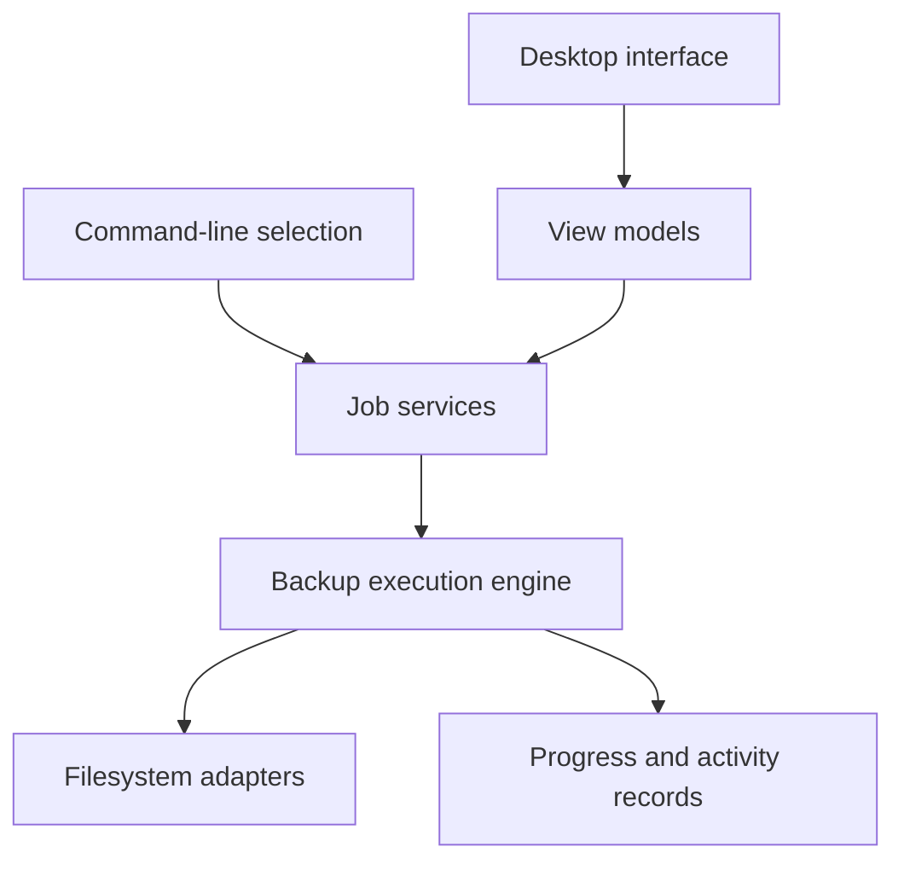

# EasySave — Backup Job Manager — Architecture

Users define source and destination locations, choose a backup mode and follow the execution of their jobs. The project combines a desktop interface with a backup engine, progress tracking, logging and coordination rules for concurrent transfers.

## Components

| Component | Responsibility |
|---|---|
| Desktop views | Avalonia screens for job creation, execution and preferences. |
| View models | MVVM state and commands for user interactions. |
| Backup engine | Job orchestration, file selection and transfer execution. |
| Coordination services | Priority, large-file and business-software coordination. |
| Persistence and logging | Job configuration, execution state and activity records. |
| Platform adapters | Filesystem access and operating-system-dependent behavior. |

## Main interactions

## Responsibility boundaries

- Use MVVM for the desktop interface. UI state and commands can be tested separately from the visual controls.
- Separate file selection from copying. Full and differential behavior can share the execution infrastructure.
- Coordinate shared transfer constraints centrally. Parallel jobs can honor common priority and resource rules.

## Constraints

Backup correctness depends on filesystem permissions, source availability and the reliability of the destination; a completed UI action must not conceal a failed transfer.

## Technology

C#/.NET, Avalonia, MVVM, JSON/XML logging and automated .NET tests.
